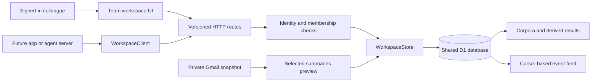

# Shared workspace MVP: implementation and extension guide

## Start here

This adds `/team` and `/api/v1` to Brief. Team members on different machines read the **same stored artifact**, with a stable ID, author, checksum, and source links. A corpus, a fold, or a future app’s result uses the same ownership and access rules.

A **workspace** is the authorization unit. An **artifact** is an immutable, JSON-serializable result owned by that workspace. A **corpus** is a collection of stored text extracts. A **fold** is a derived result referring to an existing corpus. Membership grants access to artifacts; it does not grant access to another member’s Gmail account.

### Implemented user journey

1. Sign into the Site. Open **Team workspace** from the inbox.
2. Create a named workspace; its creator becomes its permanent owner.
3. Under **Publish**, paste text, preview the extracted corpus, then publish it. Or supply a custom artifact JSON envelope.
4. Under **People**, create a single-use editor or viewer invitation. Copy the invitation yourself. The app does not send email.
5. A colleague who can access the Site signs in and redeems the invitation. Both users see the same result and can export identical JSON.
6. An editor opens a corpus and chooses **Create fold**. The stored result attributes the fold to that editor and links to the original corpus. A viewer can read both.
7. The owner creates a scoped integration key. A server-side app can publish any namespaced result and read results or events through the same interface.
8. For Gmail, connect and refresh the existing default account, choose **Share to team**, select messages, review summaries, then publish. No background task automatically shares mail.

The library refreshes every 15 seconds while visible and on focus. This is polling, not live collaborative text editing. Every published artifact is immutable; changing a result means publishing a new artifact with the previous artifact ID in `parentIds`.

## Code map

| File | Responsibility |
| --- | --- |
| `lib/workspaces/contracts.ts` | Browser/integration wire types, built-in kinds, request limit |
| `lib/workspaces/client.ts` | Typed browser/server client; authentication headers and structured errors |
| `server/workspaces/store.ts` | Membership enforcement, artifact persistence, atomic events, invites, integration credentials, pagination |
| `server/workspaces/validation.ts` | Bounded JSON parsing, schemas, canonical JSON and SHA-256 |
| `server/workspaces/processors.ts` | Deterministic text extraction and corpus-to-fold transformation |
| `server/workspaces/gmail-adapter.ts` | Owner-scoped private snapshot → explicit shared-data preview |
| `app/api/v1/[...path]/route.ts` | HTTP routing, human/integration authentication, CSRF, request IDs |
| `components/team-workspace.tsx` | Workspace switcher, library, publishing, membership and integration management |
| `components/artifact-content.tsx` | Known corpus/fold renderers and safe JSON fallback for other kinds |
| `components/share-inbox.tsx` | Explicit Gmail selection, preview, and publication |
| `db/schema.ts` | Drizzle schema; migrations remain the production schema authority |
| `drizzle/0002_steep_mandrill.sql` | Six new tables and their indexes; no legacy-table changes |
| `tests/workspaces.test.ts` | Real SQLite-backed D1 adapter, migration and HTTP integration tests |
| `docs/openapi.json` | Machine-readable OpenAPI 3.1 contract |
| `examples/publish-result.ts` | Executable example of an external producer and subsequent read |

The external seam is `WorkspaceClient`/HTTP. The internal module is `WorkspaceStore(db, principal)`. Construct it once per request after authentication. Do not accept a principal or role from request JSON. Future adapters return `ArtifactInput`; they must publish through `WorkspaceStore.publish`, not insert into tables independently.



## Ownership and permissions

| Action | Owner | Editor | Viewer | Read key | Write key |
| --- | --- | --- | --- | --- | --- |
| List/read/export artifacts; list members; read events | Yes | Yes | Yes | Yes | Yes |
| Publish result; preview text; run built-in fold | Yes | Yes | No | No | Yes |
| Preview/share own Gmail snapshot | Yes | Yes | No | No | No |
| Invite, revoke invites, change/remove members | Yes | No | No | No | No |
| Create/list/revoke integration keys | Yes | No | No | No | No |
| Create/list own workspaces; redeem invitation | Yes | Yes | Yes | No | No |

- Browser identity comes from dispatch-authenticated `oai-authenticated-user-id` and `oai-authenticated-user-email`. Display names are informational. **These headers are trusted only behind the Sites dispatcher**, not on an exposed standalone Worker. If you move hosting, replace this trust model with verified sessions/JWTs and strip spoofable identity headers at ingress.
- Browser writes require an `Origin` exactly equal to `APP_URL`, or the request origin if `APP_URL` is absent. Never relax this to `*`.
- External requests use `Authorization: Bearer bwk_…`. Invalid credentials fail even if a user session exists. Bearer requests without Origin are supported for servers; if they carry an Origin it must pass the same check. CORS is not enabled for arbitrary browser apps.
- Integration keys are scoped to exactly one workspace and either `read` or `write` (`write` includes read). They cannot manage people or reach legacy Gmail routes, which require human identity separately.
- Raw 256-bit invite/key secrets are returned once and persisted only as SHA-256 hashes. Revocation and expiration are checked on each authenticated request. An already executing request may complete; revocation is not retroactive erasure of content already downloaded.
- Invites are bearer capabilities: anyone with the link and Site access can redeem it for one signed-in identity. They expire in seven days. The URL keeps the token in its fragment, which the browser removes when the page loads. The user clicks Join explicitly. Invites are not email-bound in this MVP.
- A redeemed invitation never upgrades/downgrades an existing member. A removed member cannot rejoin using their old consumed invitation; the owner must issue a fresh invitation.
- The creator is the sole owner; owner removal/demotion is blocked. Ownership transfer is a future feature requiring atomic safeguards.
- Every artifact lookup is constrained by workspace. Every parent must resolve within that workspace. No cross-workspace parent links or public artifact URLs exist.
- Member removal does not erase authored team results. Gmail disconnect removes the private cache using the existing flow; explicitly published copies remain team-owned.

### Two access layers on a hosted Site

The Site currently has owner-only hosting access. App-level invitations do **not** modify the Sites sharing policy. Before a colleague can reach `/team`, the Site owner must grant them viewer access through Sites sharing, then grant app workspace membership with an invitation. Granting Site **viewer** access is sufficient; collaborators do not need permission to edit the Site source. Do not make private knowledge public just to enable integrations.

For non-browser server integrations on a private Site, the dispatcher can require `OAI-Sites-Authorization: Bearer <platform bypass credential>` **in addition to** `Authorization: Bearer <workspace key>`. The client has a `sitesAuthorization` option for this. The platform credential is sensitive and broader than a workspace key; keep both in the trusted integration server’s secret store. No application key alone bypasses a private Site’s access gate. If a provider cannot meet the host access requirements, put a properly authenticated gateway in front of the workspace interface; do not embed host credentials in user-facing frontend code.

## Database model and transaction behavior

| Table | Key/index | Contents |
| --- | --- | --- |
| `workspaces` | UUID primary key | Name, creator, creation time |
| `workspace_members` | `(workspace_id,user_id)` primary key; user index | Human role, name, joined time |
| `workspace_invites` | UUID; unique token hash; workspace index | Role, creator, expiration, claimed user, revocation |
| `workspace_tokens` | UUID; unique token hash; workspace index | Integration name, scope, creator, expiration, revocation |
| `workspace_artifacts` | UUID; unique `(workspace_id,created_by,request_key)`; `(workspace_id,created,id)` index | Immutable JSON result plus provenance and integrity metadata |
| `workspace_events` | Monotonic integer sequence; `(workspace_id,sequence)` index | Event type, actor, subject, timestamp; no payload copies or secrets |

Foreign keys link all six structures through workspace identity. Role and token scope values have SQL CHECK constraints. Parent IDs are validated by the module and stored as JSON; artifacts cannot currently be deleted, so valid parent links cannot become dangling through the interface.

Workspace creation, invitation redemption, artifact publication, and management writes record their event in the same D1 `batch` as the mutation. [Cloudflare documents batch statements as transactional, rolling back the sequence on failure](https://developers.cloudflare.com/d1/worker-api/d1-database/#batch). The SQLite-backed tests exercise rollback, unique constraints, race winners and real queries rather than string matching SQL.

Invitation claim uses a guarded update followed by membership insertion only if the claim changed a row. Replays verify existing membership; a consumed invitation cannot resurrect removed access. Artifact publication uses a database unique key to resolve concurrent retries; only the winning insert produces an event.

### Legacy schema repair

Before this change, `db/schema.ts` described multi-account columns that were absent from both migration history and the running Gmail implementation. Generating a migration from those declarations attempted destructive table rebuilds and copied nonexistent columns. The declarations now match the existing single-account migrations and runtime. The workspace migration creates only the six new tables. No applied migration was rewritten.

The Gmail adapter accepts `accountId: "default"` and queries `snapshots` by authenticated user. Multi-account Gmail is **not** implemented by this workspace layer. A future multi-account feature must migrate and update OAuth, refresh, reads, sends, disconnect, scheduler, UI and the adapter together; do not add account columns only to the schema.

## Artifact contract

A publish request is a JSON object with these exact required fields:

```json
{
  "kind": "research.analysis",
  "schemaVersion": 1,
  "title": "Launch research synthesis",
  "summary": "Three decisions derived from the source corpus.",
  "content": {"decisions": [{"text": "Review onboarding", "sourceDocumentIds": ["doc-1"]}]},
  "provenance": {"adapter": "research-agent", "processor": "synthesis-v1", "sourceRevision": "r42"},
  "parentIds": ["EXISTING_CORPUS_UUID_IN_THIS_WORKSPACE"]
}
```

- `kind`: lowercase namespaced identifier (`^[a-z][a-z0-9_-]*(\.[a-z][a-z0-9_-]*)+$`), max 100 characters. `brief.*` is reserved for registered built-ins.
- `schemaVersion`: integer 1–10000. Built-in corpus and fold currently accept only 1. Custom versions are preserved without interpreting their payload.
- `title`: 1–160 characters; `summary`: 0–2000 characters.
- `content` and `provenance`: JSON objects. Provenance is **caller-declared** processing metadata; it is not proof of provider origin. The server separately stamps actor identity and creation time. Do not authorize anything using provenance, URLs or IDs inside content.
- `parentIds`: up to 20 distinct artifact IDs. All parents must already exist in the same workspace. This makes lineage acyclic because artifacts are immutable and edges point to pre-existing records.
- Requests and canonical artifact envelopes are limited to 256 KiB; JSON depth is limited to 20. Metadata remains inline in D1. Attachments and large binary corpora require the future R2 work described below.
- Server fields: `id`, `workspaceId`, `createdBy` (`user:<id>` or `integration:<id>`), `authorName`, `created` (Unix milliseconds), `checksum` (lowercase hex SHA-256 of canonical content).
- Checksum canonicalization sorts object keys lexicographically, retains array order, and uses JavaScript JSON scalar formatting. It is the project’s convention, **not** an assertion of RFC 8785 compliance or a digital signature. Port clients carefully if computing checksums outside JavaScript.
- Unknown custom kinds render as escaped JSON and export unchanged. The application does not execute scripts, HTML, URLs, or tools supplied in results.

### Corpus v1

```json
{
  "documents": [{"id":"doc-1","title":"Planning","text":"The stored extract.","source":"Text import"}],
  "method": "extractive-v1",
  "originalBytes": 24000,
  "storedTextBytes": 2400
}
```

Corpora have 1–200 unique document IDs (max 160 characters); titles and source labels max 240; text max 16000. The text processor accepts 120000 source characters, divides on blank lines, collapses whitespace, and keeps the first 500 characters per passage. It rejects more than 200 passages rather than silently dropping documents. This is **lossy extractive compression**, not lossless compression, embeddings, model synthesis, or a guarantee that all important facts survive. The UI shows exactly what will be stored. Original and stored byte counts refer to text, not serialized JSON size.

Gmail uses the selected cached message summaries (`cached-ai-summaries` or `cached-extracts`). The shared document includes message ID, subject, sender name, and summary. Full body, mailbox address, sender address, account token, Gmail action headers and unsubscribe links are excluded. Sensitive facts may still appear in summaries; review remains necessary. The preview is computed server-side from the owner’s snapshot, not caller-supplied email bodies.

### Fold v1

```json
{
  "method":"source-fold-v1",
  "documentCount":1,
  "groups":[{"source":"Text import","documentIds":["doc-1"],"text":"Planning: The stored extract."}]
}
```

The built-in fold groups documents by exact source label, takes up to 240 text characters per document and caps each group’s text at 12000 characters. It retains all group citation IDs so the source extracts remain reachable. It does not invoke a model. There must be one parent, which must be a corpus; every group citation must exist in that corpus. The saved result includes the processor version and parent checksum. This reusable corpus fold is separate from the inbox’s transient grouping of related operational notifications.

## HTTP contract

Base path: `/api/v1`. No browser local storage is authoritative. All responses use `Cache-Control: private, no-store`.

| Method/path | Request | Result/permission |
| --- | --- | --- |
| `GET /workspaces` | — | `{items: Workspace[]}` for human |
| `POST /workspaces` | `{name}` | Workspace, 201; human |
| `POST /join` | `{token}` | `{workspaceId}`; human |
| `GET /workspaces/:ws/artifacts` | query `q`, `kind`, `limit`, `cursor` | Metadata page; read |
| `POST /workspaces/:ws/artifacts` | ArtifactInput + `Idempotency-Key` | `{artifact,replayed}`, 201/200; write |
| `GET /workspaces/:ws/artifacts/:id` | — | Full artifact; read |
| `POST /workspaces/:ws/artifacts/:id/fold` | `Idempotency-Key` header | `{artifact,replayed}`, 201/200; write |
| `POST /workspaces/:ws/preview` | `{title,text}` | Unsaved ArtifactInput; write |
| `POST /workspaces/:ws/capture` | `{accountId:"default",messageIds,title}` | `{preview,previewHash}`; human write |
| `POST /workspaces/:ws/capture` | above + `{publish:true,previewHash}` + `Idempotency-Key` | Saved artifact; rejects changed snapshot with 409 |
| `GET /workspaces/:ws/members` | — | `{items: Member[]}`; read |
| `PATCH /workspaces/:ws/members/:userId` | `{role:"editor"|"viewer"}` | `{ok:true}`; owner |
| `DELETE /workspaces/:ws/members/:userId` | — | `{ok:true}`; owner |
| `GET /workspaces/:ws/invites` | — | Latest 100 metadata records; owner |
| `POST /workspaces/:ws/invites` | `{role:"editor"|"viewer"}` | `{id,token,role,expires}`, 201; owner |
| `DELETE /workspaces/:ws/invites/:id` | — | `{ok:true}`; owner |
| `GET /workspaces/:ws/tokens` | — | Latest 100 metadata records; owner |
| `POST /workspaces/:ws/tokens` | `{name,scope:"read"|"write",days?:1..90}` | `{id,name,token,scope,expires}`, 201; owner; defaults 30 days |
| `DELETE /workspaces/:ws/tokens/:id` | — | `{ok:true}`; owner |
| `GET /workspaces/:ws/events` | `after` integer, `limit` 1–100 | `{items,nextAfter,hasMore}`; read |

Artifact list defaults to 30 entries, maximum 100; newest first with `(created,id)` tie breaker. `q` performs a literal, case-insensitive title/summary substring search (not full text of content). `kind` is an exact filter. `nextCursor` is opaque to clients: pass it back unchanged and keep search/filter values unchanged. The cursor is not a permission credential. New arrivals can precede an in-progress traversal; refresh the first page to see them.

Event feed defaults to 50 rows, ascending global sequence filtered to workspace. IDs may have gaps. `after=0` starts at the beginning. `nextAfter` stays unchanged if no events are returned. `latest=true` returns a descending recent window for UI activity; **consumers must omit `latest`** when advancing their durable cursor.

Successful responses carry `X-Request-Id`. Errors return `{error,code,requestId}` with a useful HTTP status; human 401 responses may include a top-level `signInUrl` for navigation. Handle 400/413/415 as invalid input, 401 as sign-in/key renewal, 403 as insufficient permission, 404 as inaccessible/missing resource, 409 as replay conflict or stale preview, and 500 as a retryable server failure. Unknown resource methods currently return 404 (root workspace methods return 405).

### Retry and concurrency rules

`Idempotency-Key` is required for direct artifact publication, Gmail publication, and folds. It is 1–128 characters. Reuse it for the same logical operation, including after a timeout; do not generate a new key for each HTTP retry. The server scopes it to `(workspace,authenticated actor,key)` and hashes the complete normalized artifact input. Same input/key returns the same artifact (200). Different input/key returns 409. Two actors using the same key are independent producers.

The UI keeps one key while reviewing/publishing a text result. Built-in fold UI uses `source-fold-v1:<parentId>`, allowing one fold per parent/processor/actor with safe replay. Metadata differences also count as different input. Include an immutable source revision and processor version in producer operation keys.

Gmail capture rechecks the snapshot hash before publication. If the inbox changed, it returns 409 and requires a fresh preview even if an earlier publication may have succeeded. Inspect the workspace library after an uncertain response; use the saved artifact’s ID before starting another operation.

Workspace, invitation and key creation are not idempotent in this MVP. Buttons disable while pending. After an uncertain response inspect existing metadata; a lost key response requires revoking that key and creating another because raw secrets cannot be recovered.

## Run and validate

Use the existing Node 22.13+ environment and lockfile. The tests use the Node SQLite API available in that runtime (some versions print an experimental warning).

```sh
npm install
npm test
npx tsc --noEmit
npm run build
```

The test runner bundles all `tests/*.test.ts` with the existing esbuild toolchain and injects test identity/runtime bindings. It executes every generated migration against real SQLite. It does not call real Gmail or create hosted user data. Tests cover ownership, viewer/editor roles, immutable reads, parent isolation, idempotency races, atomic rollback, invitation races/revocation/expiry, role removal, integration scope and revocation, pagination/search, custom schemas, size limits, private Gmail projection, stale preview rejection, and the full HTTP path from preview to teammate read.

For local D1, use the existing Wrangler configuration and apply the SQL migrations before calling authenticated routes. The canonical workspace migration is `0002_steep_mandrill.sql`; it contains only CREATE TABLE/INDEX statements. Sites applies committed Drizzle migrations during deployment. Never create tables at request time, rewrite an applied migration, or ship the development SQLite database.

Plain unauthenticated HTTP can render the team page, but its API returns 401 with a sign-in path. The Sites dispatcher owns production sign-in. Do not add a development authentication bypass to production. Local testing of human flows should use the isolated test harness or a trusted dispatcher, not a public endpoint accepting arbitrary identity headers.

### Run the example producer

Set these only in your integration’s server environment:

- `BRIEF_URL`: deployed Site origin.
- `BRIEF_WORKSPACE_ID`: copy the selected workspace ID from the Integrations endpoint display.
- `BRIEF_INTEGRATION_KEY`: a write key created under Integrations.
- `BRIEF_SITES_BYPASS_TOKEN`: hosting-layer credential if required by the Site access policy.

```sh
npx esbuild examples/publish-result.ts --bundle --platform=node --format=esm --outfile=work/publish-result.mjs
node work/publish-result.mjs
```

This intentionally publishes an example record only when you execute it. Replace the sample producer data and fixed source revision for real integrations. It uses the committed TypeScript client, publishes once, then retrieves that same artifact. Do not put these environment values into `NEXT_PUBLIC_*`, source code, build artifacts, or browser storage.

## Recipe for a future app adapter

1. Read this guide, the contract types, route handler and store before changing schema. Reuse the workspace identity; never create a database keyed by machine path or local username.
2. Keep provider authentication in that integration’s backend. Fetch only the provider data authorized for the intended workspace. The artifact interface does not store provider credentials.
3. Convert the provider output into an `ArtifactInput`. Use a stable app namespace, explicit schemaVersion, a title useful to humans, JSON content, and producer/revision metadata. Use source artifact IDs in `parentIds` when processing an existing shared result.
4. For a custom kind such as `linear.issue_digest`, the current backend already accepts/stores it and the current frontend displays escaped JSON. No schema migration or kind allowlist update is needed outside the reserved `brief.*` namespace.
5. If the custom kind needs stronger validation or a richer reader, add a versioned validator in `validation.ts` and a renderer in `artifact-content.tsx`. Keep the generic reader for unknown versions; reject unsupported built-in versions explicitly.
6. Publish through `WorkspaceClient.publish` on a trusted server with an operation key derived from `(adapter,sourceRevision,processorVersion)`. Keep the key under 128 characters (hash long source IDs).
7. Add integration tests using the SQLite-backed setup: wrong workspace denied, viewer cannot write, same source retry returns same ID, changed payload with old key returns 409, invalid parent denied, and two users can read the identical persisted output.
8. Add a row to the API/adapter docs only if you introduce a new operation. Most adapters need no new route.

### Event consumer algorithm

Use an external scheduled worker/queue initially. The current application does not pretend to run a durable job system or deliver outbound webhooks.

```text
cursor = loadPersistedCursor(integrationId, workspaceId)
page = client.events(workspaceId, cursor)
for event in page.items in ascending sequence:
    if event.type == "artifact.created":
        parent = client.get(workspaceId, event.subjectId)
        if parent.kind is an input kind this consumer processes:
            result = process(parent)  // constrain untrusted content; record version
            client.publish(workspaceId, result,
                           stableKey(consumerVersion, parent.id))
    persistCursor(integrationId, workspaceId, event.sequence)
if page.hasMore: drain the next page
otherwise: poll later with backoff
```

Only checkpoint after the effect is safely stored. A crash between publish and checkpoint replays safely through the same operation key. Filter input kinds so the consumer does not process its own outputs forever. After a 401/403 stop and surface revoked credentials; do not blindly retry. Back off on transient 5xx/timeouts. This gives at-least-once processing with idempotent result storage, not exactly-once execution of arbitrary external side effects.

### Next changes with precise scope

- **Large corpora / files:** introduce R2 and an artifact blob manifest with media type, object key, size and checksum. Authorize uploads/downloads using workspace membership. Finalize only verified uploads; handle orphan cleanup and object retention. Keep small JSON metadata in D1. Do not serialize megabyte/base64 blobs into existing content fields.
- **Long-running model jobs:** add `workspace_jobs` with immutable input IDs, processor/model version, status (`queued/running/succeeded/failed`), lease expiry, attempt count, retry key and output artifact ID. Claim atomically; finalize artifact and job completion in one batch. Execute through a durable queue. Poll jobs in the UI; never mark complete before the result is persisted. Model prompts must treat source content as data rather than instructions.
- **Provider OAuth managed by Brief:** add workspace-scoped encrypted connections, provider-specific scopes, explicit source sharing rules, and a revocation flow. Preserve human OAuth ownership and confirm which data becomes visible to the team. Do not reuse a member’s Gmail refresh token as a team credential.
- **Editable named documents:** add a separate mutable document/head record with compare-and-swap `revision`, referencing immutable artifacts. Return 409 on stale edits. Do not overwrite `workspace_artifacts.content`.
- **Ownership transfer:** atomically promote one existing member, update workspace ownership, demote the previous owner, handle integration-key ownership, and guarantee exactly one owner before exposing UI controls.
- **Deletion / retention:** add explicit owner-controlled tombstones with an event, link semantics, export behavior, R2 cleanup and policy for derived artifacts. Current artifacts have no delete endpoint. Revoking a member/key cannot retract copies already exported.
- **Webhook delivery:** extend the transactionally written event feed with a separate delivery table/queue, HMAC signature, event ID, replay timestamp, bounded retries and an SSRF-safe destination policy. Keep downstream delivery out of the artifact commit transaction.
- **Scale and abuse controls:** add per-workspace storage quotas and actor rate limits before broad external rollout. Current lists and payloads are bounded, but total workspaces/results are not quota-limited. Add indexed full-text search or a dedicated search module only when needed; current search is substring matching on metadata.

## Practical limits and verification boundary

The implemented MVP is a shared durable result registry with usable human workflows and integration interfaces. It has no distributed job runner, live co-editing, outbound webhooks, vector index, binary uploads, automatic provider connectors beyond the explicit Gmail snapshot adapter, semantic AI compression, email-bound invitations, ownership transfer, or result deletion.

Automated tests verify multiple independent identities against real SQLite and the application’s HTTP handlers. Type checking and the production build verify integration with the existing app. Live Gmail and actual multi-person sign-in require configured Google credentials and the Site’s sharing grants. Browser interaction QA has not been claimed. Add new tests for new invariants rather than mirroring implementation details.
